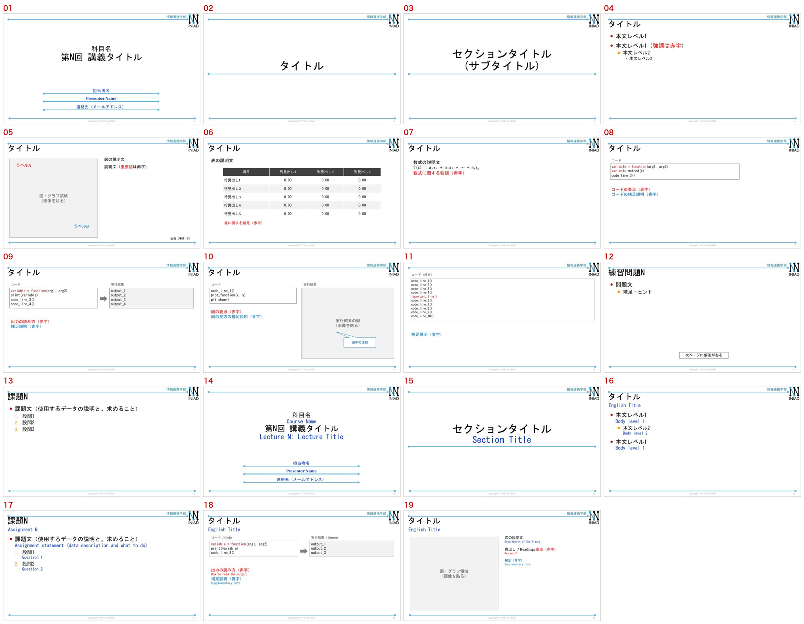
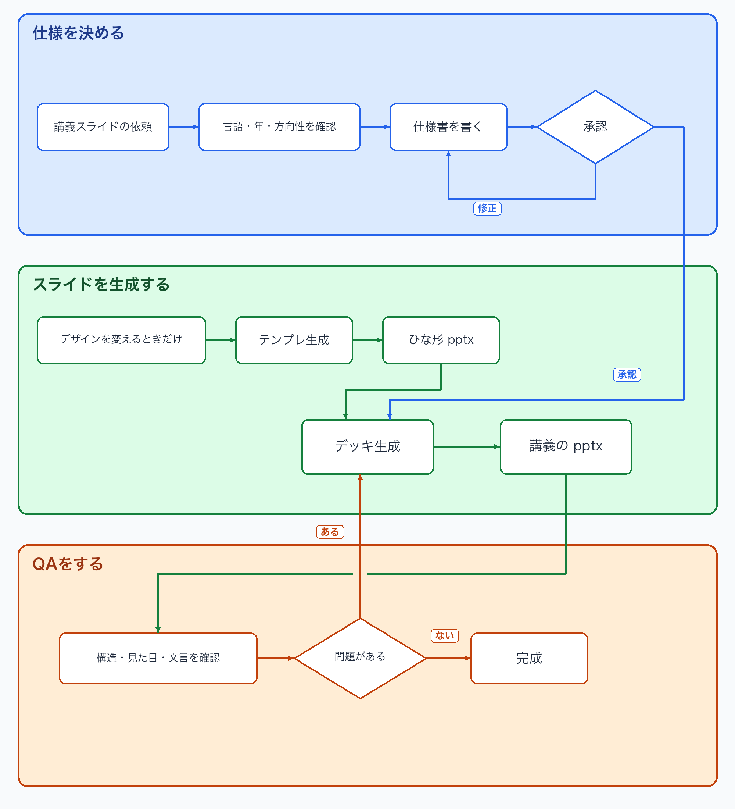

# creating-iniad-pptx

INIAD（東洋大学 情報連携学部）の講義スライドのデザインで、PowerPoint（.pptx）の講義資料を生成する **AI エージェント用のスキル**です。スキルは Agent Skills 形式（`SKILL.md`）で書かれています。

作りたい講義のテーマを伝えるだけで、INIAD の講義資料と同じ見た目のスライドを作ります（水色のライン、右上のロゴ、赤い ● とオレンジの ■ の箇条書き、コード枠など）。途中で仕様書の確認を挟みます。

> **非公式のスキルです。** INIAD・東洋大学が作成・配布しているものではありません。デザインは公開されている講義資料をもとに再現したものです。



## 推奨する AI エージェント

| エージェント | スキルの置き場所 |
|---|---|
| [Claude Code](https://claude.com/claude-code) | `~/.claude/skills/`（プロジェクト単位なら `<プロジェクト>/.claude/skills/`） |
| [Codex](https://github.com/openai/codex) | `~/.codex/skills/` |

Agent Skills 形式に対応したほかのエージェントでも使えます。質問用のツールが無いエージェントでは、選択肢をチャットで示して回答を待ちます（`SKILL.md` の「他の AI エージェント・Windows で使う場合」を参照）。

## 特徴

- **INIAD の講義資料のデザインを再現したテンプレート**: スライドマスター・9 種類のレイアウト・19 枚の見本スライドを同梱しています。見本は講義表紙、中扉、本文、図＋説明、表、数式、コード解説、コード＋実行結果、練習問題、課題などです
- **日本語のみ / 日英併記 / 英語のみ** に対応しています。日英併記では、日本語の直後に英語を青字で添える INIAD の形式で作ります
- **仕様書を承認してから生成**: 生成の前に、1 ページずつの内容（文言・図・コード・表）を書いた仕様書を作ってユーザーの承認を得ます。plan モードや仕様駆動開発と同じ進め方です
- **スクリーンショットの撮影**: Playwright で Jupyter Notebook の実行画面や Web ページを撮り、スライドに貼れます（コードを実行してから撮るのにも対応しています）
- **ユーザーの画像を使える**: `user-images/` に置いた画像を、指示に応じてスライドに配置します
- **生成スクリプトが残る**: デッキごとに生成スクリプト（python-pptx）を出力するので、後から修正して作り直せます

## 技術スタック

| 区分 | 技術 | 役割 |
|---|---|---|
| 手順 | Agent Skills（`SKILL.md`） | 言語・年の確認、仕様書の承認、生成と QA の進め方 |
| 生成 | Python 3.9 以上、[python-pptx](https://python-pptx.readthedocs.io/) | ひな形 pptx を開き、講義のページを描いて保存する |
| 画像 | [Pillow](https://python-pillow.org/) | 画像の縦横比を保ってスライドに配置する |
| QA | [markitdown](https://github.com/microsoft/markitdown) | スライドの文字を抜き出し、ひな形のダミー文言や `YYYY` の残りを探す |
| QA | LibreOffice（`soffice`） | できた pptx を PDF にする |
| QA | Poppler（`pdftoppm`） | PDF をページごとの画像にして、はみ出しや重なりを見る |
| QA | pptx スキル | pptx の構造を検査する |
| スクリーンショット（任意） | Playwright、Chromium、nbconvert | Jupyter の実行画面や Web ページを撮る |

Python のパッケージは `requirements.txt` にあり、スクリーンショット用は `requirements-screenshot.txt` です。どちらもスキル直下の venv に入れます。

## 必要なもの

| 必要なもの | 用途 |
|---|---|
| AI エージェント（Claude Code / Codex など） | スキルの実行 |
| pptx スキル（Anthropic の [skills](https://github.com/anthropics/skills) の `pptx`） | 生成した pptx の検証と画像化（QA）。Claude Code ではプラグイン `document-skills` などで入る |
| Python 3.9 以上 | 生成スクリプトの実行 |
| LibreOffice（`soffice`） | pptx を PDF にして見た目を確認する |
| Poppler（`pdftoppm`） | PDF を画像にする |
| Playwright + Chromium（任意） | スクリーンショットを撮るときだけ |

Python のパッケージは、スキル直下の仮想環境（venv）に入れて使います。システムの Python には入れません。

## インストール

### 1. スキルを配置する

このリポジトリの `creating-iniad-pptx-skill/` を、使うエージェントのスキルの置き場所に `creating-iniad-pptx` という名前でコピーします。

**macOS / Linux**

```bash
# Claude Code
cp -r creating-iniad-pptx-skill ~/.claude/skills/creating-iniad-pptx
# Codex
cp -r creating-iniad-pptx-skill ~/.codex/skills/creating-iniad-pptx
```

**Windows（PowerShell）**

```powershell
# Claude Code
Copy-Item -Recurse creating-iniad-pptx-skill "$HOME\.claude\skills\creating-iniad-pptx"
# Codex
Copy-Item -Recurse creating-iniad-pptx-skill "$HOME\.codex\skills\creating-iniad-pptx"
```

pptx スキルが入っていない場合は、Anthropic の [skills](https://github.com/anthropics/skills) リポジトリの `skills/pptx` を同じ置き場所にコピーします（Claude Code ではプラグインから入れることもできます）。

### 2. 外部ツールを入れる

**macOS（Homebrew）**

```bash
brew install python
brew install --cask libreoffice
brew install poppler
```

**Windows（winget）**

```powershell
winget install Python.Python.3.12
winget install TheDocumentFoundation.LibreOffice
winget install oschwartz10612.Poppler
```

winget で入れたあとは、ターミナルを開き直すと PATH が反映されます。LibreOffice は PATH に入らないことがありますが、要件チェッカーは既定のインストール先も探します。Linux の手順は [references/system-requirements.md](references/system-requirements.md) にあります。

### 3. venv を作って依存パッケージを入れる

スキルを配置したフォルダで実行します。

**macOS / Linux**

```bash
cd ~/.claude/skills/creating-iniad-pptx      # Codex なら ~/.codex/skills/creating-iniad-pptx
python3 -m venv .venv
.venv/bin/pip install -r requirements.txt

# スクリーンショットも使う場合
.venv/bin/pip install -r requirements-screenshot.txt
.venv/bin/python -m playwright install chromium
```

**Windows（PowerShell）**

```powershell
cd "$HOME\.claude\skills\creating-iniad-pptx"   # Codex なら "$HOME\.codex\skills\creating-iniad-pptx"
py -m venv .venv
.venv\Scripts\pip install -r requirements.txt

# スクリーンショットも使う場合
.venv\Scripts\pip install -r requirements-screenshot.txt
.venv\Scripts\python -m playwright install chromium
```

### 4. 要件を確認する

```bash
.venv/bin/python scripts/check_requirements.py        # macOS / Linux
.venv\Scripts\python scripts\check_requirements.py    # Windows
```

`[必須]` がすべて OK になれば準備完了です。

## 使い方

エージェントに、作りたいスライドのテーマを伝えます。

```
<テーマ>の講義スライドを作って
INIAD のテンプレートで、<テーマ>の演習スライドを作って
user-images の <ファイル名> を使って、<テーマ>のスライドを作って
```

スキルは次の順に進めます。青が仕様、緑がスライド生成、橙が QA です。



1. **方向性の確認**: 言語（日本語のみ / 日英併記 / 英語のみ）、Copyright の年、ビジュアル表現の度合い、情報密度を選択式で聞きます
2. **仕様書の作成と承認**: `output/<デッキ名>/spec.md` に、1 ページずつの内容（使う見本・文言・コード・表・図の描き方・画像）を書きます。一覧を示して承認を求め、承認されるまでスライドは作りません
3. **生成**: 仕様書どおりの生成スクリプト `output/<デッキ名>/build.py` を書いて実行します
4. **QA**: pptx の構造チェックに加えて、全スライドを画像にして、はみ出しや重なりを確認して直します。仕様から変える必要が出たときは、先に仕様書を直します
5. **完成**: `output/<デッキ名>/<デッキ名>.pptx` ができます

表紙の担当者名・連絡先と「第N回」は、ダミーのまま出力されます。完成後に書き換えてください。

### 画像を使う

スライドに入れたい画像は `user-images/` に置き、ファイル名を指定して頼みます。サブフォルダで講義ごとに分けても構いません。このフォルダの中身は Git の管理から外してあります。

### スクリーンショットを撮る

エージェントが必要に応じて撮りますが、手動でも使えます（Windows では `.venv/bin/python` を `.venv\Scripts\python` に読み替えてください）。

```bash
# 「# %%」でセルを区切った .py を実行して、2〜3 番目のセルを撮る
.venv/bin/python scripts/screenshot.py pycode demo.py --cells 2-3 -o output/<デッキ名>/shots/demo.png

# Web ページの中の図を撮る（まず候補を一覧で確認してから番号を指定する）
.venv/bin/python scripts/screenshot.py url <URL> -o - --selector "article img" --scroll --list
.venv/bin/python scripts/screenshot.py url <URL> --selector "article img" --nth 3 --scroll -o output/<デッキ名>/shots/fig3.png
```

他のサイトの図を使うときは、スライドに出典を入れます。個人情報が写っていないことも確認してください。

## フォルダ構成

```
creating-iniad-pptx-skill/
├── SKILL.md                    # スキル本体（エージェントが読む手順とルール）
├── assets/
│   ├── iniad-template.pptx     # テンプレート（マスター・レイアウト・見本 19 枚）
│   ├── iniad-logo.png          # ロゴ（テンプレートに埋め込み済み）
│   └── thumbnails/             # 見本スライドのサムネイル
├── references/
│   ├── brand-tokens.md         # 色・フォント・座標の確定値
│   ├── spec-template.md        # 仕様書の形式と承認の取り方
│   ├── slide-details/          # 見本スライドごとの枠と座標
│   └── system-requirements.md  # 環境ごとの準備手順（macOS / Windows / Linux）
├── scripts/
│   ├── iniad_deck.py           # デッキを組む部品（python-pptx）
│   ├── screenshot.py           # スクリーンショット撮影（Playwright）
│   ├── build_template.py       # テンプレートの生成
│   ├── dump_slide_details.py   # slide-details の生成
│   ├── prepare_logo.py         # ロゴ画像の加工（余白カット・背景透過）
│   ├── set_copyright_year.py   # Copyright の年の置換
│   └── check_requirements.py   # 要件チェッカー
├── examples/
│   └── deck_skeleton.py        # 生成スクリプトのひな形（ダミー文言）
├── docs/
│   ├── catalog.png             # README 用の見本一覧
│   └── overall-flow.png        # README 用の全体の流れ
├── user-images/                # ユーザーが使いたい画像を置く場所（中身は Git 管理外）
├── output/                     # 生成物の出力先（中身は Git 管理外）
├── requirements.txt
└── requirements-screenshot.txt
```

## 注意事項

- **フォント**: テンプレートは INIAD の資料と同じ Meiryo UI（コードは Consolas）を指定しています。Windows では標準で入っているため、正しく表示されます。macOS の LibreOffice でのプレビューは代わりのフォントで表示されるため、字の幅や見た目が PowerPoint と少し異なります
- **Copyright の年**: テンプレートでは `YYYY` になっています。生成のたびに年を確認し、置き換えます
- **内容の正確さ**: スライドの内容は AI が書きます。仕様書の段階で内容を確認し、特に数値・法律・固有名詞は公開前に必ず確かめてください
- **引用した画像**: Web から撮ったスクリーンショットの利用条件は、元のサイトの規約に従ってください

## テンプレートを作り直す

色や座標を変えるときは、テンプレートを直接編集せず、生成スクリプトを直して作り直します。

```bash
.venv/bin/python scripts/build_template.py assets/iniad-template.pptx
.venv/bin/python scripts/dump_slide_details.py assets/iniad-template.pptx references/slide-details
```

サムネイルの作り直しなどの詳しい手順は、[SKILL.md](SKILL.md) の「テンプレ更新時の再ベイク手順」にあります。

## ロゴと名称について

- `assets/iniad-logo.png`（テンプレートに埋め込まれたロゴを含む）と、「INIAD」「情報連携学部」の名称・標章の権利は、それぞれの権利者（INIAD・東洋大学）に帰属します。**これらはこのリポジトリのコードとは別の扱いで、ライセンスの対象外です**
- ロゴや名称は、INIAD の講義資料の作成など、正当な目的の範囲でのみ使ってください
- このスキルは非公式のもので、INIAD・東洋大学とは関係がありません
